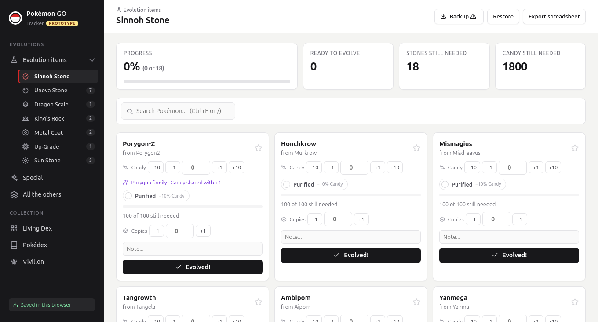

# 🎒 PoGo Tracker

A fan-made app to keep track of your Pokémon GO progress. It is a single page (`index.html`): no sign-up, no server, no ads.

## Features

- **Evolution items:** Sinnoh Stone, Unova Stone, Dragon Scale, King's Rock, Metal Coat, Up-Grade and Sun Stone, each with a count of what is still missing.
- **Special evolutions and all the others:** Candy, copies and priorities for every evolution. Candy is shared by the whole family: update it on one card and the whole line follows. Purified Pokémon get the 10% Candy discount.
- **Living Dex:** which Pokémon you keep in storage, by region, with hints about what you can get by evolving something you already have.
- **Pokédex:** registered, ✨ shiny, 🍀 lucky and ⭐ 3 stars, with types and stats.
- **Vivillon:** the 18 regional patterns for the medal plus the event ones, step by step (Scatterbug → Spewpa → Vivillon), with Candy spent.
- **🎯 Hunt list:** mark what you are looking for and filter by it.

## How to use

Download `index.html` and open it in your browser (or use the GitHub Pages link, if there is one).
Your progress is saved **only in your browser**, and nothing is sent anywhere.
Use **Backup** now and then to download a copy, and **Restore** to bring it back or move it to another device.
Clearing your browser data erases any progress that is not in a backup.

This is a prototype: feedback and ideas are welcome in the Issues tab.

## Disclaimer

Fan project, non-commercial. Not affiliated with Niantic, Nintendo, Game Freak or The Pokémon Company.
Pokémon and Pokémon names are trademarks of their respective owners.
